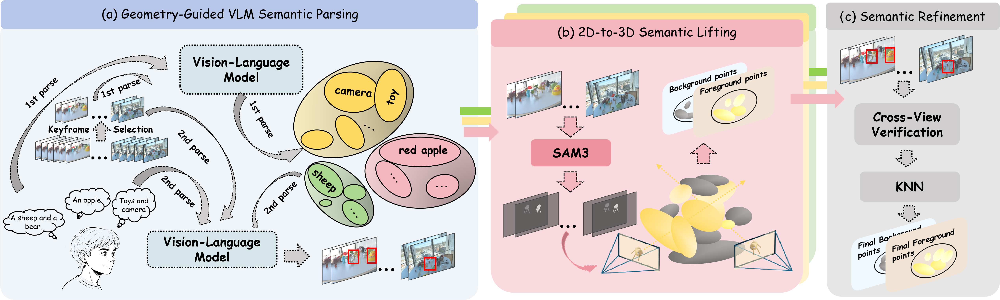

<div align="center">

# [ECCV 2026] ZeroSplat: Generalized Referring Segmentation in 3D Gaussian Splatting

<h3>
  <a href="https://arxiv.org/abs/2607.18801">Paper</a> |
  <a href="https://inkmind-ai.github.io/ZeroSplat/">Project Page</a> |
  <a href="https://huggingface.co/datasets/jiayuttkx/GR-LERF">GR-LERF</a> |
  <a href="https://huggingface.co/datasets/jiayuttkx/GR-ScanNet">GR-ScanNet</a>
</h3>

</div>

ZeroSplat segments language-specified targets in an existing 3D Gaussian Splatting (3DGS) scene. The implementation combines geometry-based keyframe selection, vision-language model (VLM) parsing, SAM3 masks, and multi-view label lifting and refinement. It uses a reconstructed 3DGS model without additional scene-specific semantic training.

This repository provides the inference pipeline, benchmark evaluation scripts, and the project website. Data, pretrained weights, and SAM3 source code are not included.

<p align="center">
  
</p>

## 0. Installation

### 0.1 Pipeline Environment

Use a CUDA-capable environment with PyTorch, a compatible CUDA toolkit, and a C++ compiler. Install PyTorch for your system first, following the [official instructions](https://pytorch.org/get-started/locally/). The CUDA extensions below must match that environment.

```bash
git clone https://github.com/InkMind-AI/ZeroSplat.git
cd ZeroSplat

# Run these commands inside your PyTorch + CUDA environment.
python -m pip install -e submodules/simple-knn
python -m pip install -e submodules/diff-gaussian-rasterization
python -m pip install -e submodules/zero-rasterization
python -m pip install -r requirements.txt
```

The extension sources are included under `submodules/`. The repository does not provide an `environment.yml` or pin a complete dependency stack.

### 0.2 SAM3

Install the [official SAM3 repository](https://github.com/facebookresearch/sam3) and its dependencies. Clone it, or link an existing checkout, as `sam3_main/` at the ZeroSplat repository root. Place the checkpoint at `sam3_main/sam3.pt`:

```text
ZeroSplat/
└── sam3_main/
    ├── sam3/
    └── sam3.pt
```

The pipeline imports `sam3_main.sam3`; installing SAM3 only into site-packages does not satisfy this layout. A local checkpoint avoids the model builder's fallback to loading weights from Hugging Face.

### 0.3 VLM Endpoint

The referring-segmentation pipeline requires an OpenAI-compatible API that supports image inputs. Pass the API key, base URL, and served model name explicitly. No credentials or data roots are bundled.

For local serving, install [vLLM](https://github.com/vllm-project/vllm) in a **separate environment**. It is not a pipeline dependency and is not included in `requirements.txt`. For example, after obtaining compatible Qwen3-VL weights:

```bash
# Run in the separate VLM server environment.
vllm serve /path/to/Qwen3-VL-30B-A3B-Instruct \
  --host 127.0.0.1 --port 8001 \
  --dtype bfloat16 \
  --served-model-name qwen3-vl-30b-a3b-instruct

# Check that the server is ready.
curl -s http://127.0.0.1:8001/v1/models
```

Follow the [vLLM installation documentation](https://docs.vllm.ai/en/latest/getting_started/installation/) for your hardware and model. Use the literal key `EMPTY` for a local endpoint without authentication. For an authenticated endpoint, use your own credentials and keep them out of committed files.

---

## 1. Overview and Repository Layout

The pipeline consists of three stages:

1. **Geometry-guided keyframe selection:** export depth maps and select weighted voxel-covering frames for GR-LERF, Ref-LERF, and GR-ScanNet.
2. **VLM parsing and SAM3 segmentation:** parse referring expressions, localize targets, generate and merge 2D masks, and extract projection coordinates. LERF and ScanNet use the category prompts already defined in the code, without VLM parsing.
3. **3D lifting and refinement:** accumulate mask contributions on Gaussians, check cross-view consistency, apply referring-box constraints where available, and spread labels with KNN.

```text
ZeroSplat/
├── main.py                 # End-to-end orchestration
├── voxel_grid_main.py      # Depth export and keyframe selection
├── mask_generator.py       # VLM parsing, SAM3 masks, and projections
├── render.py               # Label lifting, refinement, and rendering
├── preprocess/             # Dataset prompts, JSON readers, and VLM requests
├── voxel_code/             # Geometry and keyframe selection helpers
├── render_code/            # Backprojection, box filtering, and KNN refinement
├── eval/                   # LERF, Ref-LERF, GR-LERF, and ScanNet evaluators
├── submodules/             # Three CUDA extensions
├── index.html              # GitHub Pages project page
└── static/                 # Existing website images, videos, and styles
```

The `train` and `test` folders used by rendering identify camera splits and label-lifting stages. They do not indicate a new neural-network training procedure.

---

## 2. Data Preparation

### 2.1 Supported Benchmarks

Prepare the existing benchmark inputs and reconstructed 3DGS models separately. Follow each benchmark's access conditions and license.

| Benchmark | `--dataset_type` | Folder under the data root | Rendering iteration |
| --- | --- | --- | --- |
| [GR-LERF](https://huggingface.co/datasets/jiayuttkx/GR-LERF) | `grlerf` | `grlerf/` | 30000 |
| [Ref-LERF](https://huggingface.co/datasets/FudanCVL/Ref-Lerf) | `Ref-lerf` | `Ref-lerf/` | 30000 |
| [LERF](https://www.lerf.io/) | `lerf` | `lerf/` | 30000 |
| [GR-ScanNet](https://huggingface.co/datasets/jiayuttkx/GR-ScanNet) | `gr_scannet` | `gr-scannet/` | 90000 |
| [ScanNet](http://www.scan-net.org/) | `scannet` | `scannet/` | 90000 |

**Dataset names are case-sensitive.** In particular, `gr_scannet` is the CLI type, while `gr-scannet/` is the directory name.

### 2.2 Scene Layout

Use a data root containing the benchmark folders:

```text
[DATA_ROOT]/
├── grlerf/<scene>/
├── Ref-lerf/<scene>/
├── lerf/<scene>/
├── gr-scannet/<scene>/
└── scannet/<scene>/
```

Each scene needs its reconstructed Gaussian model, source images, and camera calibration. Depending on the prepared scene format, camera metadata is read from COLMAP `sparse/0/` or `transforms_train.json` and `transforms_test.json`.

```text
<scene>/
├── point_cloud/iteration_<ITERATION>/point_cloud.ply
├── images/                         # LERF-family images
├── color/                          # ScanNet-family images, instead of images/
├── sparse/0/                       # COLMAP scene format
└── transforms_train/test.json       # Alternative transform-based scene format
```

Additional benchmark-specific inputs are:

- **GR-LERF:** `<scene>/json/` for referring expressions and `<scene>/mask/` for evaluation masks.
- **Ref-LERF:** `<scene>/json/test_json/` and `<scene>/mask/`.
- **LERF:** evaluation masks under `lerf/label/<scene>/gt/`; category prompts are defined in [`preprocess/pre_dataset.py`](preprocess/pre_dataset.py).
- **GR-ScanNet:** referring-expression JSON under `<scene>/<scene>_text/`, plus the label PLY referenced by the ground-truth JSON. Use the benchmark's prepared point and label files; their point counts and ordering must match the reconstructed model.
- **ScanNet:** `<scene>/<scene>_vh_clean_2.labels.ply`, with the same point correspondence as the model. The evaluator checks point counts and warns about sampled coordinate mismatches.

Scene names and evaluation frames are defined in [`preprocess/pre_dataset.py`](preprocess/pre_dataset.py) and the dataset evaluators. The LERF-family examples use `ramen`, `figurines`, `teatime`, and `waldo_kitchen`. Arbitrary new scene names are not automatically registered.

---

## 3. Inference and Rendering

### 3.1 Run a Referring-Segmentation Scene

Set the pipeline interpreter and data root to your local paths. Use the interpreter from the environment containing PyTorch, SAM3, and the CUDA extensions.

```bash
export PY=/path/to/pipeline-env/bin/python
export DATA=/path/to/prepared-data
export VLM_API_KEY=EMPTY
export VLM_BASE_URL=http://127.0.0.1:8001/v1
export VLM_MODEL_NAME=qwen3-vl-30b-a3b-instruct

# Run from the ZeroSplat repository root.
"$PY" main.py \
  --base_data_dir "$DATA" \
  --gs_python "$PY" \
  --dataset_type Ref-lerf \
  --dataset_name ramen \
  --iteration 30000 \
  --api_key "$VLM_API_KEY" \
  --base_url "$VLM_BASE_URL" \
  --model_name "$VLM_MODEL_NAME" \
  --k 40 --threshold 0.8
```

For GR-LERF, change `--dataset_type` to `grlerf` and use the corresponding prepared scene.

### 3.2 GR-ScanNet

```bash
"$PY" main.py \
  --base_data_dir "$DATA" \
  --gs_python "$PY" \
  --dataset_type gr_scannet \
  --dataset_name scene0000_00 \
  --iteration 90000 \
  --api_key "$VLM_API_KEY" \
  --base_url "$VLM_BASE_URL" \
  --model_name "$VLM_MODEL_NAME" \
  --k 40 --threshold 0.8
```

### 3.3 LERF and ScanNet

These paths use the code-defined category prompts and do not invoke the VLM. Run SAM3 and rendering directly, without supplying a VLM endpoint:

```bash
# LERF
"$PY" mask_generator.py \
  --base_data_dir "$DATA" --dataset_type lerf --dataset_name ramen \
  --iteration 30000 --skip_vlm
"$PY" render.py \
  --base_data_dir "$DATA" --dataset_type lerf --dataset_name ramen \
  --k 40 --threshold 0.8

# ScanNet
"$PY" mask_generator.py \
  --base_data_dir "$DATA" --dataset_type scannet --dataset_name scene0000_00 \
  --iteration 90000 --skip_vlm
"$PY" render.py \
  --base_data_dir "$DATA" --dataset_type scannet --dataset_name scene0000_00 \
  --k 40 --threshold 0.8
```

Although `main.py` accepts both dataset types, it still validates VLM arguments unless `--skip_mask` or `--proj_only` is set. The separate-stage commands above avoid that unnecessary requirement.

### 3.4 Options and Output Files

| Option in `main.py` | Behavior |
| --- | --- |
| `--voxel_size` | Voxel size for keyframe selection; default `0.1` |
| `--k`, `--threshold` | KNN refinement settings; defaults `40` and `0.8` |
| `--skip_voxel`, `--skip_mask`, `--skip_render` | Skip the corresponding stage; downstream stages still need its outputs |
| `--skip_train`, `--skip_test` | Skip the corresponding rendering split |
| `--keep_artifacts` | Preserve previous mask/VLM and render outputs instead of cleaning them |
| `--proj_only` | Rebuild projections from existing localization JSON; referring datasets only |

**Iteration handling:** `main.py` defaults to 30000 for the LERF family and 90000 for the ScanNet family. Its `--iteration` override reaches keyframe selection and mask projection, but `render.py` currently fixes the rendering iteration by dataset family. Use the iterations listed in Section 2 for a consistent end-to-end run.

**Reruns:** mask generation and rendering clean their previous outputs by default. Back up results you need to retain, and use `--keep_artifacts` when deliberately reusing them. In particular, `--skip_train` requires existing lifted labels and `--keep_artifacts` so rendering does not remove those labels before the test split loads them. Keyframe/depth exports can still be rewritten.

Typical referring-pipeline outputs under each scene are:

```text
<scene>/
├── depth_image/                     # Exported depth maps
├── scannet_weighted_frames.json     # Selected keyframes
├── llm_ayal.json                    # VLM category parsing
├── vlm_visual_results/
│   ├── localization_results.json
│   └── proj.pth
├── sam3_mask/                       # Per-expression 2D masks
├── zero_out/<expression>/
│   ├── train/ours_<ITERATION>/label_refinement/refined_labels.pth
│   └── test/ours_<ITERATION>/pred_mask/
└── knn_label/                       # KNN-refined Gaussian labels
```

### 3.5 Run Stages Separately

```bash
# A. Depth export and keyframe selection
"$PY" voxel_grid_main.py \
  --base_data_dir "$DATA" --dataset_type grlerf --dataset_name ramen \
  --iteration 30000

# B. VLM parsing, SAM3 masks, and projection coordinates
"$PY" mask_generator.py \
  --base_data_dir "$DATA" --dataset_type grlerf --dataset_name ramen \
  --iteration 30000 \
  --api_key "$VLM_API_KEY" --base_url "$VLM_BASE_URL" \
  --model_name "$VLM_MODEL_NAME"

# C. 3D label lifting, KNN refinement, and rendering
"$PY" render.py \
  --base_data_dir "$DATA" --dataset_type grlerf --dataset_name ramen \
  --k 40 --threshold 0.8
```

`mask_generator.py` also supports `--vlm_only`, `--skip_vlm`, and `--proj_only`. These three modes are mutually exclusive. For a referring dataset, `--skip_vlm` requires an existing `llm_ayal.json`, and `--proj_only` requires `vlm_visual_results/localization_results.json`.

---

## 4. Evaluation

Run evaluation **after generating predictions**. Match the iteration and KNN settings to the inference run. Metrics are printed to the terminal; the commands below do not supply benchmark data or create ground-truth labels.

### 4.1 GR-LERF and Ref-LERF

These evaluators compare rendered 2D masks and report mIoU and accuracy at IoU thresholds 0.25 and 0.50.

```bash
# GR-LERF
"$PY" eval/lerf_reflerf/run_reflerf_eval.py \
  --dataset_type grlerf --scene_name ramen \
  --gt_base "$DATA/grlerf/ramen/mask" \
  --pred_base "$DATA/grlerf/ramen/zero_out" \
  --json_path "$DATA/grlerf/ramen/json" \
  --iteration 30000

# Ref-LERF
"$PY" eval/lerf_reflerf/run_reflerf_eval.py \
  --dataset_type Ref-lerf --scene_name ramen \
  --gt_base "$DATA/Ref-lerf/ramen/mask" \
  --pred_base "$DATA/Ref-lerf/ramen/zero_out" \
  --json_path "$DATA/Ref-lerf/ramen/json/test_json" \
  --iteration 30000
```

### 4.2 LERF

```bash
"$PY" eval/lerf_reflerf/run_lerf_eval.py \
  --scene_name waldo_kitchen \
  --gt_base "$DATA/lerf/label/waldo_kitchen/gt" \
  --pred_base "$DATA/lerf/waldo_kitchen/zero_out" \
  --iteration 30000
```

This evaluator also reports mIoU and accuracy at IoU thresholds 0.25 and 0.50.

### 4.3 GR-ScanNet

Evaluate KNN-refined point labels against the benchmark's 3D ground truth:

```bash
"$PY" eval/gr_scannet/run_gr_scannet_eval.py \
  --data_root "$DATA/gr-scannet" \
  --scene_name scene0000_00 \
  --iteration 90000 --k 40 --threshold 0.8
```

Use `--scene_list` for several scenes, or omit both scene options to evaluate the built-in ten-scene subset. Ground-truth JSON is auto-detected under `<scene>_text/`; `--gt_json` can override its scene-relative path.

### 4.4 ScanNet

```bash
# Refined labels before KNN spreading
"$PY" eval/scannet/run_scannet_eval.py \
  --data_root "$DATA/scannet" \
  --scene_list scene0000_00 \
  --iteration 90000 --num_classes 19

# KNN-refined labels
"$PY" eval/scannet/run_scannet_eval.py \
  --data_root "$DATA/scannet" \
  --scene_list scene0000_00 \
  --iteration 90000 --num_classes 19 \
  --use_knn --k 40 --threshold 0.8
```

`--num_classes` supports `10`, `15`, or `19`. Omitting `--scene_list` uses the built-in ten-scene subset. Both ScanNet-family evaluators report mIoU, accuracy, and mean class accuracy. Their visualization helpers are placeholders in the current release, so visualization flags do not provide implemented image exports.

### 4.5 Batch GR-ScanNet

Replace the scene list with the supported scenes you have prepared:

```bash
for scene in scene0000_00 scene0062_00 scene0070_00; do
  "$PY" main.py \
    --base_data_dir "$DATA" --gs_python "$PY" \
    --dataset_type gr_scannet --dataset_name "$scene" --iteration 90000 \
    --api_key "$VLM_API_KEY" --base_url "$VLM_BASE_URL" \
    --model_name "$VLM_MODEL_NAME" --k 40 --threshold 0.8 && \
  "$PY" eval/gr_scannet/run_gr_scannet_eval.py \
    --data_root "$DATA/gr-scannet" --scene_name "$scene" \
    --iteration 90000 --k 40 --threshold 0.8
done
```

---

## 5. Acknowledgements and License

ZeroSplat includes code derived from [3D Gaussian Splatting](https://github.com/graphdeco-inria/gaussian-splatting), including rasterization, scene handling, and utility components. SAM3 is installed separately from its [official repository](https://github.com/facebookresearch/sam3); local VLM serving can use [vLLM](https://github.com/vllm-project/vllm).

The repository is distributed under the **ZeroSplat Research License for non-commercial research and evaluation**. Third-party components retain their original license terms and copyright notices. See [`LICENSE`](LICENSE), [`NOTICE`](NOTICE), and the licenses under each `submodules/` directory.

---

## 6. Citation

For the paper's BibTeX entry, see the [Citation section on the project page](https://inkmind-ai.github.io/ZeroSplat/#bibtex). The paper is available at [arXiv:2607.18801](https://arxiv.org/abs/2607.18801). Paper authorship and third-party attribution are separate from repository maintenance.

---

## 7. Contact and Troubleshooting

For code questions or reproducibility issues, open a [GitHub issue](https://github.com/InkMind-AI/ZeroSplat/issues).

- **CUDA extension import errors:** build all three extensions with the same Python, PyTorch, and CUDA environment used for the pipeline.
- **Python source decoding errors:** the current `arguments/__init__.py` contains non-UTF-8 bytes. An encoding conversion is needed if Python rejects that file; dependency installation does not fix source encoding.
- **SAM3 import or checkpoint errors:** verify the `sam3_main/` source layout and local checkpoint path in Section 0.2.
- **Local VLM connection errors:** check `/v1/models`, the model name, and the base URL. If proxy settings interfere with localhost, inspect `ALL_PROXY`, `HTTP_PROXY`, `HTTPS_PROXY`, and their lowercase variants, or configure `NO_PROXY` for `127.0.0.1,localhost`.
- **Missing predictions or lifted labels:** verify that the preceding stage completed, the scene folder matches the dataset type, and rerun cleanup did not remove outputs you intended to reuse.
- **Unexpectedly low or empty evaluation:** inspect the evaluator's warnings. Missing predictions can be scored as empty outputs or skipped, depending on the evaluator; a printed metric alone does not confirm a complete prediction set.

The repository does not include a complete pinned environment or an end-to-end automated test suite. Run on your prepared data and inspect stage logs before treating evaluation output as a reproduced result.
